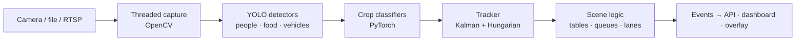

# TableSense

**Real-time computer vision for restaurants.** TableSense watches camera feeds and tells staff
what needs attention *right now*: guests waiting to order, tables waiting for the check, tables
that need clearing, food going cold at the pass, and how long the queues are, both at the door
and in the drive-thru lane.

> 🚧 **Work in progress, built in public and test-first.** The behavior of each component is
> specified by its tests first, then implemented. Failing tests mark what's still being built.
> Demo video, benchmarks and results will appear here as milestones land.

<!--  -->

## What it does

| | |
|---|---|
| 🍽️ **Table states** | A state machine per table: `EMPTY → SEATED → ORDERED → EATING → FINISHED → NEEDS_BUSSING`, with timed alerts ("Table 4: waiting to order for 6 min") |
| 🧑‍🍳 **Staff vs guests** | Tells staff from guests to know when a table was actually visited |
| 🥗 **Food vision** | Detects plates, glasses and dishes; classifies plate state (full / partly eaten / empty); optional dish recognition |
| 🚶 **People tracking** | Stable anonymous IDs per person (Kalman filter + Hungarian matching, ByteTrack-style low-score association) |
| 🚗 **Drive-thru traffic** | Vehicle tracking, directional line counters, time in lane, speed via homography |
| ⏱️ **Queues** | People in the queue zone and estimated wait |
| ⚡ **Real-time** | Threaded capture with drop-oldest queues, per-stage timing, p50/p95 latency; target ≥ 15 FPS at 720p on an Apple M1 (ONNX Runtime / CoreML) |
| 📊 **Dashboard** | FastAPI REST + WebSocket events, live annotated stream, Docker |

Privacy by design: no face recognition, no license plates, no identity storage. Tracks are
anonymous and temporary.

## How it works



Details: [docs/ARCHITECTURE.md](docs/ARCHITECTURE.md) (data contracts, the state machine, the
real-time model, evaluation plan) · [docs/DATA.md](docs/DATA.md) (sources, datasets, privacy).

**Stack:** Python 3.12 · OpenCV · NumPy · PyTorch · Ultralytics YOLO · SciPy · ONNX Runtime ·
CoreML · FastAPI · JAX · pytest · uv · Docker

## Quick start

```bash
uv sync                                       # core environment
uv run python scripts/check_env.py            # verify setup
uv run python scripts/make_synthetic_video.py # render the synthetic test scene
uv run pytest                                 # run the test suite
```

Heavier dependencies are optional extras: `uv sync --extra dl` (PyTorch, YOLO),
`--extra track`, `--extra deploy`, `--extra jax`.

Tests don't need real video: `tablesense.testing.synthetic` renders a small restaurant scene
with exact ground truth (who is where, in every frame), so tests are deterministic and run in CI.

## Roadmap

| Milestone | Status |
|---|---|
| **A** Zones and classic motion-based occupancy (no deep learning) | 🚧 in progress |
| **B** YOLO detection and multi-object tracking | ⬜ |
| **C** Table states, alerts, queue and drive-thru lane analytics | ⬜ |
| **D** Custom-trained people, food and vehicle models, with an evaluation report | ⬜ |
| **E** 15+ FPS, multi-camera, dashboard, Docker, benchmark table | ⬜ |
| **F** Demo video, results, model cards | ⬜ |

## License

[MIT](LICENSE)
