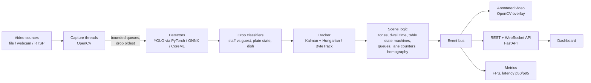
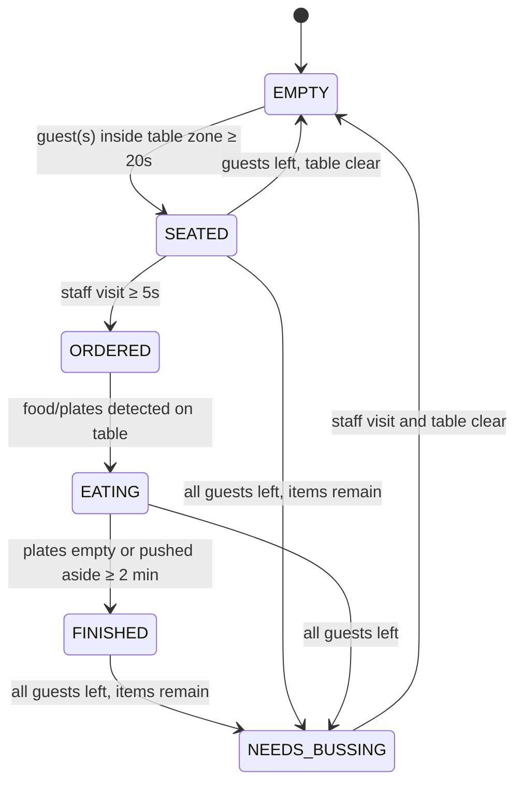

# TableSense — Architecture

> Real-time computer vision for restaurants. TableSense watches camera feeds and tells staff
> **what needs attention right now**: guests waiting to order, tables waiting for the check,
> tables that need clearing, food waiting at the pass, and how long the queues are, both at the
> door and in the drive-thru lane.

---

## 1. The problem (in restaurant terms)

A busy restaurant loses money and goodwill in small gaps:

| Situation | Cost | What TableSense detects |
|---|---|---|
| Guests sit down and nobody comes to take the order | Bad reviews, walkouts | Table is `SEATED` and no staff visit for more than N minutes |
| Guests finished eating, waiting for the check | Slow table turnover | Plates empty or pushed aside, guests still seated |
| Guests left, table still dirty | New guests can't be seated | No people at the table, items still on it |
| Plated food sitting at the kitchen pass | Cold food, complaints | Food items in the pass zone longer than N seconds |
| Long queue at the door or counter | Walkaways | People in the queue zone, estimated wait |
| Slow drive-thru lane | Cars leave the line | Vehicles per hour, time in lane, cars waiting at each stage |

Anyone can understand the demo: *a restaurant video with colored boxes over each table and a
sidebar saying "Table 4: waiting to order, 6m 12s".*

### Three camera views, one pipeline

| View | What is detected and tracked | Main output |
|---|---|---|
| **Dining floor** | People (guests vs staff), tables | Table states, service alerts, door queue |
| **Food and tableware** | Plates, bowls, cups, dishes, plate state (full / partly eaten / empty) | Course progress per table, food waiting at the pass |
| **Drive-thru / curbside** | Cars, trucks, motorbikes | Lane counts, time in lane, speed and stop detection |

The same capture → detect → track → logic → events pipeline serves all three. Only the models,
zones and rules change. That generality is a design goal: it's the same system that would
count traffic on a street or track people in a store.

### Non-goals (deliberate)
- **No face recognition and no identity storage.** People and vehicles are anonymous track IDs
  that only last while they're in view. No license plate reading. An optional privacy mode blurs
  heads in saved output.
- No point-of-sale integration. Vision only.
- No cloud dependency at runtime. It runs on one machine (an Apple Silicon laptop or an edge box).

---

## 2. System overview



### Package layout

```
src/tablesense/
├── geometry.py      # boxes, polygons, masks, drawing, homography helpers
├── video.py         # frame sources, threaded capture, FPS/latency meters
├── motion.py        # background subtraction, zone activity, debounced occupancy
├── classify.py      # PyTorch crop classifiers: staff vs guest, plate state, dish type
├── detect.py        # Detector interface, IoU, NMS, YOLO / ONNX / CoreML backends
├── track.py         # Kalman filter, assignment, SORT/ByteTrack-style tracker
├── scene.py         # zones, dwell timers, TableStateMachine, QueueMonitor
├── lanes.py         # line-crossing counters, lane monitor, speed via homography
├── events.py        # event types and event bus
├── pipeline.py      # stages wired together with threads/queues, per-stage timing
├── app.py           # FastAPI app and dashboard
└── testing/
    └── synthetic.py # deterministic synthetic restaurant video for tests
```

---

## 3. Data contracts

Every stage talks to the next one through small, typed, immutable records. These are what make
the system testable: each stage can be tested on its own with fake inputs.

```python
@dataclass(frozen=True)
class Frame:
    index: int  # monotonically increasing frame number
    timestamp: float  # seconds, from time.monotonic() at capture
    image: np.ndarray  # HxWx3 uint8, **BGR** (OpenCV convention)


@dataclass(frozen=True)
class Detection:
    box: tuple[float, float, float, float]  # x1, y1, x2, y2 in pixels
    score: float  # 0..1
    class_id: int
    class_name: str


@dataclass(frozen=True)
class Track:
    track_id: int
    box: tuple[float, float, float, float]
    class_name: str
    age: int  # frames since the track was created
    hits: int  # frames where it matched a detection


@dataclass(frozen=True)
class TableStatus:
    table_id: str
    state: TableState  # EMPTY, SEATED, ORDERED, EATING, FINISHED, NEEDS_BUSSING
    since: float  # timestamp the state started
    guests: int
    alert: str | None  # e.g. "waiting to order for 6m 12s"
```

**Convention:** a person's or vehicle's position on the ground is the **bottom-center of its
box**, not the box center. Zones are drawn on the floor, so that is the point that falls inside
the right zone.

---

## 4. The table state machine (the heart of the product)



Alerts are timers on states: `SEATED > 5 min` means "needs order", `FINISHED > 4 min` means
"bring the check", `NEEDS_BUSSING > 3 min` means "clear table". The thresholds live in config,
not in code.

**Staff vs guest** gets solved three times, each building on the last, with measured gains:
1. **Heuristic:** where people come from. Staff appear from the kitchen zone.
2. **Crop classifier:** a small CNN (PyTorch, transfer learning) on person crops.
3. **Custom detector:** a fine-tuned YOLO with a `staff` class.

## 5. Food vision

| Task | Approach | Why |
|---|---|---|
| Find tableware and food | YOLO: COCO classes (`cup`, `bowl`, `wine glass`, `pizza`, `sandwich`, `cake`…) as a baseline, then fine-tuned on custom labels (`plate`, `plate_full`, `plate_empty`, `glass_empty`) | Drives `ORDERED → EATING → FINISHED` |
| Plate state | Crop classifier on detected plates: full / partly eaten / empty | Cheaper than a detection class per state, easy to retrain |
| Dish recognition (optional) | Classifier fine-tuned on a Food-101 subset, applied to plate crops | "Table 4 got the burger": per-dish timing |
| Food at the pass | Dwell time of food items in the pass zone | Cold-food alerts |

## 6. Drive-thru and traffic

| Task | Approach |
|---|---|
| Detect vehicles | YOLO COCO `car`/`truck`/`motorcycle`/`bus`, optionally fine-tuned on the specific camera |
| Track vehicles | The same tracker as for people (different motion noise parameters) |
| Count | Directional **line-crossing counters**: a track's foot point crosses a line segment |
| Time in lane | Dwell time between the "enter lane" and "order point" / "pickup window" lines |
| Speed and stops | **Homography** (`cv2.getPerspectiveTransform`) maps image pixels to ground meters, so speed = distance on the ground / time. "Stopped" = speed below a threshold for N seconds |

Evaluated on a public vehicle-tracking benchmark (e.g. UA-DETRAC) as well as on drive-thru footage.

---

## 7. Real-time model

- **Target:** ≥ 15 FPS end to end at 720p on an Apple M1 (30 FPS is a stretch goal with CoreML).
  Restaurants change slowly, so 15 FPS is plenty for dining; the drive-thru view is where frame
  rate matters most (speed estimates).
- **Latency budget (66 ms at 15 FPS):** capture ~2 ms, detection ~35 ms, tracking ~2 ms,
  scene ~1 ms, rendering ~5 ms, ~20 ms of headroom.
- **Never fall behind live:** each capture thread pushes into a queue with `maxsize=2` that
  **drops the oldest frame**. Stale frames are worse than skipped frames.
- **File sources** can switch dropping off, so evaluation is deterministic and covers every frame.
- **Multiple cameras:** one capture thread per source; detection batched across cameras.
- **Detect every N frames, track in between** as a speed knob, measured against the accuracy loss.
- **Measured, not guessed:** every stage records its duration, and the pipeline reports FPS and
  latency at p50 and p95.

## 8. Models

| Model | Base | Classes | Trained on |
|---|---|---|---|
| People | YOLO11 (n/s) | `staff`, `guest` | Labeled frames from dining footage |
| Food and tableware | YOLO11 (n/s) | `plate`, `plate_full`, `plate_empty`, `cup`, `glass`, `food` | Labeled tabletop frames plus public food datasets |
| Vehicles | YOLO11n | `car`, `truck`, `motorcycle` | COCO baseline, fine-tuned on drive-thru frames |
| Crop classifiers | MobileNetV3 / ResNet18 | staff vs guest; plate state; dish (Food-101 subset) | Crops extracted by the detectors |

Every training run is logged (data version, model, image size, augmentations, mAP, FPS) in
`reports/experiments.md`.

## 9. Hardware strategy

| Task | Where | Why |
|---|---|---|
| Development, tests, classic CV | Apple M1 CPU | Fast enough |
| PyTorch inference and small training | Apple GPU via `mps` | Built into PyTorch |
| YOLO fine-tuning | Google Colab / Kaggle (NVIDIA T4) | Much faster training |
| Optimized inference | ONNX Runtime + CoreML | Apple's native accelerator path |
| TensorRT | Benchmarked on a T4 | TensorRT needs an NVIDIA GPU |

## 10. Configuration

Zones, lines and thresholds are defined per camera in YAML (see [`configs/demo.yaml`](../configs/demo.yaml)).
Pixel coordinates belong to one specific camera view, so a new video means new zones.

## 11. Evaluation

| Component | Metric | Data |
|---|---|---|
| Detectors | mAP@0.5, mAP@0.5:0.95, per-class precision and recall | Held-out split, split by video (no leakage) |
| Crop classifiers | Accuracy, confusion matrix | Held-out crops |
| Tracker | IDF1, ID switches, HOTA (via TrackEval) | MOT17 subset (people), UA-DETRAC subset (vehicles), a labeled restaurant clip |
| Table states | State accuracy, event timing error (seconds) | Hand-annotated timeline of a demo video |
| Lane counts and speed | Count error, speed error vs measured distance | Annotated drive-thru clip |
| System | FPS, latency p50/p95 per backend and model size | Benchmark script |

## 12. Testing

- **Unit tests** for every pure function (geometry, IoU, NMS, state machine), with no video needed.
- **Synthetic video** (`tablesense.testing.synthetic`) renders a fake restaurant with known
  ground truth (who is where, when), so motion, tracking and state logic tests are deterministic
  and run in CI.
- **Golden-clip tests**: short real clips with expected events, so regressions get caught.

## 13. Roadmap

| Milestone | Demo |
|---|---|
| **A: It sees** | Table zones light up when people move in them: classic CV only, no deep learning |
| **B: It knows people** | YOLO detection plus tracking, with stable IDs as people walk |
| **C: It understands tables** | Table states and alerts on real restaurant footage; drive-thru lane counts |
| **D: Custom models** | Fine-tuned people, food and vehicle models with an evaluation report |
| **E: Production-ish** | 15+ FPS, multi-camera, dashboard, Docker, benchmark table |
| **F: Polish** | Demo video, results, model cards, JAX-accelerated tracking filter |
